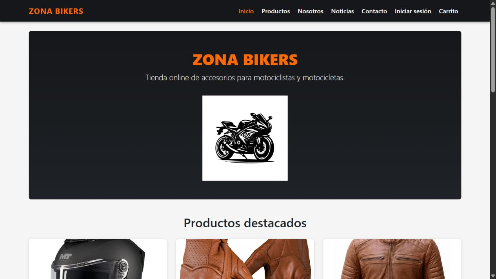
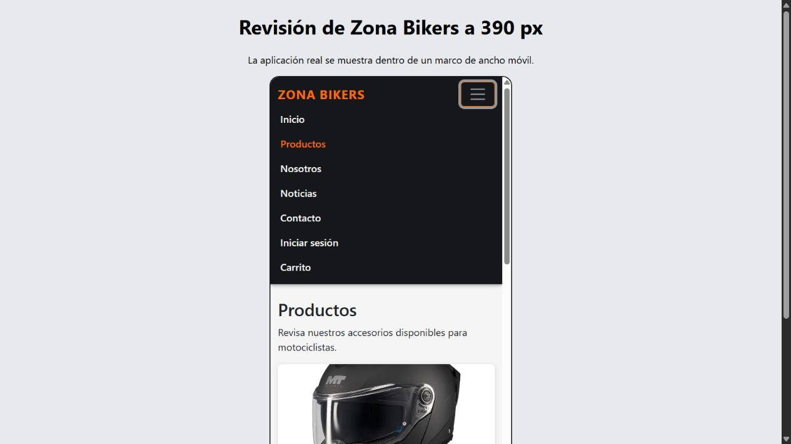

# Zona Bikers — React

Migración de Zona Bikers a React para DSY1104, Evaluación Parcial 2. Las pruebas funcionales usan **Vitest con Chromium real**, según la indicación del profesor. El frontend de la tienda persiste sus datos en el navegador; el servidor Node existente atiende el chat.

## Equipo

- Camilo Contreras: estilos y vistas.
- Víctor Salas: estructura e integración.
- Kevin Valdes: lógica y validaciones.

La entrega es de equipo y cada estudiante defiende individualmente sus decisiones y pruebas. Consultar [entregables y pendientes](docs/ENTREGA.md).

Productos permite combinar categoría y búsqueda por nombre. El menú Ofertas muestra descuentos de demostración administrables desde el formulario de productos. El precio se conserva a través de carrito, checkout y pedido. Ver [reglas de precio, compatibilidad y archivos](docs/CATEGORIAS_OFERTAS.md).

## Instalar y abrir

Requiere Node.js 24 LTS y npm. Abrir en VS Code la carpeta que contiene package.json:

```powershell
npm ci
npm run test:browser:install
npm run dev
```

Abrir la URL que muestra Vite; no abrir index.html con doble clic. Los JSON se cargan por HTTP. Playwright descarga Chromium una vez por equipo; no se depende de Chrome o Edge instalados.

## Pruebas y cobertura

```powershell
npm test
```

Ejecuta los **142 casos del frontend** (incluidos los 120 originales, 10 del checkout y 12 de categorías/ofertas) en Vitest Browser Mode con **Chromium headless de Playwright** y los **seis del servidor** con Vitest en Node. Si todo pasa, comprueba que se mantengan los casos originales y actualiza resultados y documentos de cobertura.

| Comando | Uso |
|---|---|
| `npm run test:browser:install` | Instalar Chromium. |
| `npm test` | Ambas suites, cobertura y documentación de resultados. |
| `npm run test:frontend` | Solo navegador y su cobertura. |
| `npm run test:chat` | Solo servidor y su cobertura. |
| `npm run test:coverage` | Alias del recorrido completo de npm test. |
| `npm run test:watch` | Reejecutar frontend al cambiar archivos. |
| `npm run lint` | Comprobar el código. |
| `npm run build` | Compilar para producción. |
| `npm run preview` | Abrir la compilación local. |

Los comandos parciales generan su JSON y cobertura; para actualizar los documentos consolidados usar `npm test`.

- [Plan de pruebas](docs/PLAN_PRUEBAS.md).
- [Resultados actuales y todos los casos](docs/RESULTADOS.md).
- [Documento de cobertura y análisis](docs/COBERTURA.md).
- [Cambios de migración](docs/MIGRACION_VITEST.md).
- Informes HTML: `coverage/frontend/index.html` y `coverage/server/index.html`.
- JSON: `docs/resultados-vitest-chromium.json`, `docs/resultados-vitest-servidor.json` y `docs/resultados-migracion.json`.

La cobertura del frontend incluye JS/JSX de src, excluyendo pruebas, setup y main.jsx. Mantiene umbrales globales de 90% para sentencias, funciones y líneas y 85% para ramas. El servidor se mide por separado; no tenía un umbral previo. CSS, recursos externos y arranque HTTP no se presentan como cubiertos. La comprobación inicial de 1 + 1 se mantiene separada de los casos funcionales.

Los resultados anteriores de Jasmine/Karma se conservan en `docs/historico/jasmine-karma/`. No son resultados de Vitest ni se usan como cobertura vigente. No se necesitan Karma, Jasmine, webpack ni Babel para las pruebas migradas.

## Funciones y límites

- Catálogo, inicio, detalle y relacionados desde JSON.
- Carrito con cantidades enteras, límite de stock, total y persistencia.
- Registro local, login, cierre de sesión y rutas según rol.
- CRUD de productos compartido con el catálogo y CRUD de cuentas compartido con el login.
- Equipo, noticias, módulos, menú adaptable, etiquetas, foco y salto al contenido.
- Chat Biker IA: [configuración del componente y servidor](docs/chat-gemini.md).

Productos, cuentas y carrito usan localStorage; las ediciones no reescriben los JSON. Otro navegador conserva sus propios datos. La compra es simulada: no cobra, registra pedidos ni descuenta inventario. El contacto valida sin enviar correos. El servidor atiende el chat, no el negocio de la tienda. Las pruebas usan respuestas simuladas, sin claves ni llamadas a Google.

## Cuentas de prueba

| Rol | Correo | Contraseña |
|---|---|---|
| Administrador | admin@duoc.cl | 12345 |
| Vendedor | vende@profesor.duoc.cl | vende |
| Cliente | cliente@gmail.com | moto1 |

Usar datos ficticios: las cuentas educativas se guardan en el navegador y las rutas no sustituyen la autenticación de producción. Para restaurar los datos iniciales, borrar las claves productosBikers, usuariosBikers y carritoBikers del almacenamiento de este navegador.

## Ejemplos

1. Agregar dos unidades y comprobar el total; superar el stock debe mostrar un error sin aumentar la cantidad.
2. Registrar una cuenta ficticia e iniciar sesión con ella en el mismo navegador.
3. Como administrador, crear y editar un producto, volver al catálogo y recargar: debe mantenerse el cambio.
4. Revisar noticias, fechas, menú móvil y navegación con teclado.

## Estructura

```text
src/components/        componentes React
src/pages/             rutas y formularios
src/context/           carrito compartido
src/utils/             datos, catálogo, cuentas y validaciones
src/test/setup.js      limpieza entre casos
public/data/           JSON inicial
server/                API del chat y casos Vitest en Node
scripts/               actualización automática de resultados
docs/                  plan, cobertura y evidencia
coverage/frontend/     informe del navegador
coverage/server/       informe del servidor
vitest.config.js       Chromium Browser Mode con Playwright
vitest.server.config.js Vitest en Node
```

## GitHub y publicación opcional

El flujo .github/workflows/pages.yml instala dependencias y Chromium con sus bibliotecas de Linux, comprueba el código, ejecuta ambas suites y compila. Conserva resultados y cobertura como artefactos. Usa HashRouter y base relativa para recargar rutas internas. Falta asociar el repositorio real y verificar la URL pública; esta migración no publica cambios. GitHub Pages es opcional en la pauta y no ejecuta el servidor del chat.

## Capturas existentes

Las capturas de interfaz recibidas se conservan como referencia, no como una nueva revisión visual de esta migración.




La captura antigua de cobertura pertenece a Jasmine/Karma; consultar los informes HTML actuales. La cobertura de componentes no sustituye una revisión visual en dispositivos reales.


## Cierre colaborativo

Ver [reparto en tres partes](docs/PLAN_COLABORACION.md) y [pendientes verificados](docs/CHECKLIST_CIERRE.md). El repositorio remoto todavía está pendiente de creación. La verificación de pull requests está separada de la publicación manual opcional en Pages.
